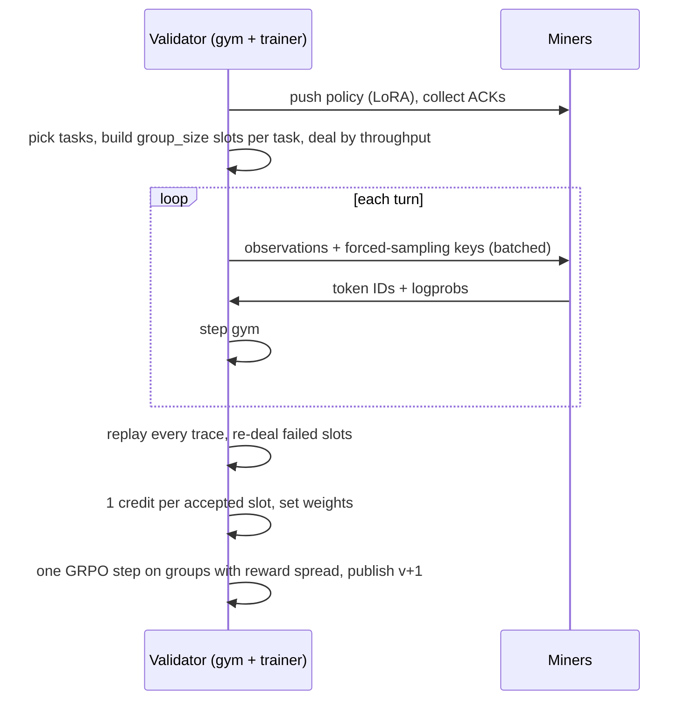

# Window protocol (v4)

1. **Tasks.** The validator picks `tasks_per_window` tasks (default 2): families in rotation, the next unplayed seed of each. Miners never see gym code; they only receive observations turn by turn.
2. **Dealing.** Each task has `group_size` rollouts (default 8). The validator shuffles all rollouts and deals them to miners in proportion to measured throughput (tokens/s, moving average; unmeasured miners count as the average). A task group usually mixes miners.
3. **Generation.** Each miner plays its rollouts in lockstep with one `/v1/generate_batch` call per turn, generated in one left-padded GPU call (`serve-miner --max-batch`, default 8). Miners run in parallel.
4. **Forced sampling.** Every token is the inverse-CDF pick of `softmax(logits / T)` at the public uniform `sha256(key, turn, position)`. The key binds window randomness, task, policy checksum and rollout index, not the hotkey, so a slot can be re-dealt with the same draws. Tokens can still differ slightly across GPUs and kernels, so replay checks them within tolerance.
5. **Acceptance.** In training mode the validator teacher-forces every trace and accepts a slot only if:
   - prompt IDs match the validator-built context and the scored text is decoded from the token IDs;
   - each turn ends at its first end-of-sequence token or after exactly `max_tokens` tokens, and every end-of-sequence is exactly the forced pick;
   - other tokens stay within `FORCED_SAMPLING_TOLERANCE` and logprobs within `LOGPROB_TOLERANCE`.

   Rejected slots are re-dealt with the same spec (`REASSIGN_ROUNDS`). Without `--train` traces are not verified.
6. **Credit and weights.** An accepted slot earns 1 credit, whatever its reward and whether its GRPO group completed; advantage is used only inside GRPO. Failures earn nothing:
   - timeout or transport error: measured throughput drops, so the miner gets fewer slots;
   - `TraceWarning` (numerical mismatch of any size): `WARNING_LIMIT` warning windows within `WARNING_HORIZON` quarantine the miner until they age out;
   - `TraceError` (a protocol violation an honest miner cannot produce: broken completion contract, rewritten context, missing trace): moving credit resets to 0 and the miner sits out `ERROR_QUARANTINE_WINDOWS`.

   Moving credit decays every window (`CREDIT_EMA_ALPHA`); weights are proportional to it and rebuilt from the ledger on restart.
7. **Training.** One GRPO step over all complete groups with reward spread. Only a changed, saved PEFT adapter is published as the next version. The trainer model and its Adam state carry over while the in-memory LoRA equals the published policy.

A group with any infrastructure failure is excluded as a whole. Zero-score rounds do not submit weights.

## Tolerance calibration

`FORCED_SAMPLING_TOLERANCE["cuda"]` was calibrated on 228 honest Qwen3-14B traces (71k tokens, L40S, batch 8, testnet): 0.4% off-pick tokens, at most 4 per trace beyond distance 0.01, largest distance 0.18. Honest traces: 0 of 228 rejected.

**Residual risk.** Inside the flip budget a miner can still choose a few reachable tokens per rollout, up to max(6, 1%) (see `test_adaptive_attacks_against_cuda_tolerances`). It cannot change pay, but bounds how much a malicious miner can shape training data.

## Identity and policy files

- Testnet uses `--chain test --wallet NAME`; the CLI refuses mainnet and HMAC fallback on testnet.
- Each `serve-miner` needs `--validator-hotkey SS58`; only these callers can generate or load policy.
- `run-window --train` needs one `--miner-hotkey SS58` per controlled miner.
- `policy/registry.json` and immutable `policy/vN/` directories survive restarts; keep them together. Paths must not contain symlinks.

Testnet runs prove verified on-policy updates, not capability gains; those need held-out evaluation.
